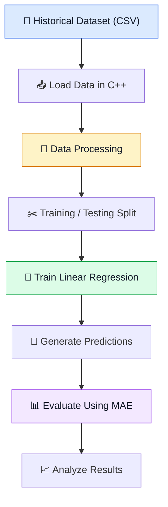

## PROJECT TITLE

# 

## PROJECT DESCRIPTION

This project aims to develop a C++ based Machine Learning that analyzes historical electricity consumption data
and predicts future consumption using Linear Regression.

The system will process historical readings, learn the relationship between relevant input variables and electricity
usage, and generate predictions for new inputs. It will also evaluate prediction accuracy by comparing predicted values
with actual readings.

The project will implement the core prediction algorithm in C++ without relying on Python. It will demonstrate fundamental
Machine Learning concepts, including data processing, model training, prediction and evaluation.

## PROJECT DELIVERABLES

1. **C++ Application:** A working program for electricity consumption prediction.
3. **Dataset:** A sample dataset containing historical electricity consumption readings.
5. **Data Processing Module:** Functionality to load and process the dataset.
7. **Machine Learning Model:** A Linear Regression algorithm implemented in C++.
9. **Prediction Module:** Functionality to estimate electricity consumption for new inputs.
11. **Evaluation Module:** Calculation of prediction errors using appropriate evaluation metrics such as MAE.
13. **Testing and Results:** Test cases and results demonstrating the model's performance.
15. **Project Documentation:** A report explaining the problem, methodology, algorithm, implementation, results and limitations.

## 🔄 Project Workflow

